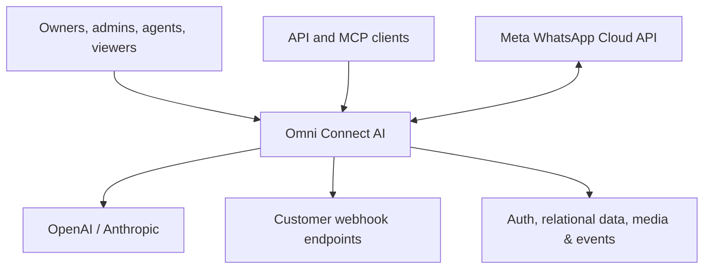

# Omni Connect AI — High-Level Product Specification

**Status:** Current-state specification derived from repository revision `80c3f9a`  
**Audience:** Product owners, architects, engineers, operators, and extension developers

## 1. Product definition

Omni Connect AI is a self-hostable, multi-user customer relationship management application centered on the official WhatsApp Business Cloud API. It combines a shared team inbox, contact management, sales pipelines, approved-message broadcasts, no-code automation and interactive conversation flows. Optional AI assistance drafts or automatically sends replies using an account's own OpenAI or Anthropic credentials and account-specific knowledge.

The product is delivered as a browser application, a scoped public REST API, inbound/outbound webhook integrations, and an optional MCP server for AI clients.

## 2. Product goals

- Give a team one account-scoped workspace for customer conversations over WhatsApp.
- Preserve a structured CRM record around each contact and conversation.
- Allow non-developers to broadcast approved templates and build automations/flows.
- Support sales pipeline tracking without leaving the messaging workspace.
- Expose secure integration surfaces through API keys, webhooks, and MCP.
- Permit self-hosting, custom branding, feature extension, and bring-your-own AI keys.
- Maintain strict tenant and role isolation for owner, admin, agent, and viewer roles.

## 3. Actors and permissions

| Actor | Primary capabilities |
|---|---|
| Owner | Full account access, ownership transfer, member/role/settings management |
| Admin | Team and configuration management, operational changes |
| Agent | Inbox, contacts, deals, broadcasts and allowed operational actions |
| Viewer | Read-only visibility into account data |
| API client | Operations allowed by its API-key scopes |
| Meta WhatsApp | Signed inbound message/status events; recipient of outbound calls |
| Scheduler/worker | Resume delayed flows/automations and scheduled broadcasts |
| MCP client | Natural-language/tool access mediated by the scoped public API |

## 4. Functional scope

### 4.1 Identity and account management

- Email/password signup, login, logout, reset, session refresh, and global sign-out.
- Automatic personal account creation for a new user.
- Invite-link membership, role assignment, member removal, and ownership transfer.
- Profile name/avatar and account currency/appearance preferences.
- Online/away/offline presence and assignment notifications.

### 4.2 Shared inbox

- Account-wide conversation list with unread state and status.
- Contact-linked message thread for text, images, documents, audio, video, location, templates, and interactive responses.
- Agent assignment, conversation state transitions, replies, reactions, quoted replies, media preview/download, and quick replies.
- Realtime updates for messages, conversations, reactions, presence, and notifications.
- Human handoff from automated flows or AI auto-reply.

### 4.3 Contacts

- Create, edit, search, import, deduplicate, and delete contacts.
- Tags with many-to-many contact assignment.
- Account-defined custom fields and values.
- Notes and linked conversations/deals.
- CSV import with validation and error visibility.

### 4.4 Sales pipelines

- Multiple account-owned pipelines and ordered stages.
- Contact/conversation-linked deals with title, value, currency, notes, close date, and lifecycle status.
- Kanban movement and pipeline analytics.

### 4.5 WhatsApp configuration and templates

- Connect one WABA/phone configuration per account.
- Encrypt access tokens at rest and verify registration/configuration.
- Synchronize, create, submit, and delete Meta message templates.
- Support text and media headers, body variables, footer, buttons, and status normalization.
- Verify inbound webhook signatures and process Meta delivery callbacks.

### 4.6 Broadcasts

- Select an approved template and target contacts through filters/tags.
- Personalize per-recipient variables and schedule or send immediately.
- Track pending, sent, delivered, read, replied, and failed recipients.
- Resume interrupted sends without duplicate recipient delivery.
- Maintain aggregate counters transactionally.

### 4.7 Automations

- Define triggers such as inbound message, new contact, keyword, or schedule.
- Build ordered/branched steps with JSON configuration.
- Execute actions such as send, tag, assign, branch, wait, and webhook.
- Persist logs and delayed execution state.
- Resume due work through an authenticated cron endpoint.

### 4.8 Interactive flows

- Visually author node graphs for messages, buttons, lists, input collection, conditions, tags, HTTP fetch, handoff, and completion.
- Validate flows before activation.
- Start flows on configured triggers, record runs/events, wait for replies, execute fallback policies, and time out safely.
- Prevent concurrent active flow conflicts for the same account/contact.

### 4.9 AI assistant

- Store an account-owned, encrypted OpenAI or Anthropic API key.
- Generate reply drafts from recent conversation context.
- Optionally auto-reply up to a per-conversation cap and hand off to a human.
- Store knowledge documents, chunk/index them, and retrieve by PostgreSQL full-text search or optional vector similarity.
- Record model/token usage by account and conversation.

### 4.10 Integration surfaces

- Public `/api/v1` with hashed, revocable, expiring, scoped API keys.
- Cursor pagination and consistent success/error envelopes.
- Account-configured outbound webhook endpoints, selected events, HMAC signatures, SSRF protection, and failure tracking.
- Separate stdio MCP server with read-only default and opt-in write tools.

## 5. System context

## 6. Logical modules

| Domain | Owns |
|---|---|
| Identity & tenancy | Users, profiles, accounts, invitations, roles, presence |
| CRM | Contacts, tags, custom fields, notes |
| Messaging | Conversations, messages, reactions, quick replies, notifications |
| Sales | Pipelines, stages, deals |
| Campaigns | Templates, broadcasts, recipients and delivery counters |
| Automation | Definitions, steps, pending executions and logs |
| Flows | Graph definitions, nodes, runs and events |
| AI | Provider configuration, knowledge, embeddings and usage |
| Integrations | WhatsApp configuration, API keys, outbound webhooks, MCP |
| Platform | Authentication, database, object storage, realtime, jobs, security |

## 7. Key business rules

1. Every business record must be scoped to exactly one account, directly or through a parent.
2. A user acts within the account and role stored on their profile.
3. One account owns at most one active WhatsApp phone configuration.
4. Access tokens, AI provider keys, and webhook secrets must never be stored plaintext or returned to the browser.
5. Meta webhook POSTs must pass HMAC verification before any mutation.
6. Message and recipient identifiers must support idempotent webhook/broadcast processing.
7. Only approved/supported templates may be used for production template sends.
8. Viewer access is read-only; progressively higher roles unlock operational and administrative writes.
9. Service/worker operations that bypass user authorization must always scope queries by `account_id`.
10. Flow and automation execution must persist audit state and be resumable after process failure.
11. API keys are displayed once, stored as hashes, scope-checked, rate-limited, revocable, and optionally expiring.
12. AI behavior is optional, account-configured, usage-recorded, capped, and capable of clean human handoff.

## 8. Non-functional requirements

### Security

- Encrypted secrets at rest with authenticated encryption.
- Secure, HTTP-only session cookies and CSRF-safe mutations.
- Tenant isolation at API/repository level and, where retained, PostgreSQL RLS.
- Least-privilege database credentials; privileged worker credentials never reach clients.
- HMAC verification/signing for inbound and outbound webhooks.
- SSRF controls for user-configured endpoints and HTTP-flow nodes.
- CSP and standard secure response headers.

### Reliability

- Idempotent inbound webhook handling.
- Durable job queue for broadcasts, AI auto-replies, webhook delivery, and delayed workflow work.
- Retry with bounded exponential backoff and dead-letter visibility.
- Transactional state changes for message delivery and aggregate counters.
- Database backups and tested restore procedure.

### Performance and scale

- Pooled PostgreSQL connections.
- Indexed account, contact, conversation, status, timestamp, and external-message identifiers.
- Cursor pagination for large lists.
- Horizontal web scaling with shared rate limits, job state, and realtime fan-out.
- Object storage for media; do not proxy large objects through application memory unnecessarily.

### Observability

- Structured logs with request/job correlation IDs and account-safe metadata.
- Metrics for webhook latency/errors, message send status, queue depth, broadcast progress, AI usage, and database saturation.
- Alerts for signature failures, repeated webhook failures, stuck jobs, and high delivery failure rates.
- Audit trails for membership, settings, credentials, and privileged operations.

### Maintainability

- Application services depend on interfaces for database, auth, storage, events, and jobs.
- Browser code communicates through stable application APIs rather than vendor-specific database SDKs.
- Schema changes use versioned migrations and are tested against empty and upgraded databases.
- Local development and production use the same PostgreSQL semantics.

## 9. Deployment profiles

### Current profile

- One Next.js Node.js container.
- Hosted or self-hosted Supabase for data platform functions.
- Optional separate MCP Node.js process.
- External Meta and AI provider APIs.

### Target local profile without Supabase

- Next.js web container.
- PostgreSQL 16+ container.
- MinIO object-storage container.
- Redis-compatible queue/event container.
- Worker container and local scheduler.
- Application-owned authentication/session schema.

### Target DigitalOcean production profile

- App Platform web service from the existing Dockerfile or Node buildpack.
- App Platform worker and scheduled jobs.
- Managed PostgreSQL through a transaction/session pool appropriate to the query layer.
- Spaces for media, Redis-compatible service for jobs/events/rate limits.
- Managed environment secrets, custom domain/TLS, logs/alerts, backups, and migration release step.

## 10. Extension principles

- Add new features inside a named domain module with explicit input/output contracts.
- Put cross-domain orchestration in application services, not UI components.
- Keep account scoping visible in every repository method signature.
- Emit domain events after successful transactions rather than coupling modules through direct UI refresh assumptions.
- Prefer background jobs for work involving Meta, AI providers, user webhooks, or large recipient sets.
- Add schema/contract tests before altering current Supabase-dependent behavior.
- Avoid a large rewrite: migrate one capability behind an adapter at a time.

## 11. Acceptance criteria for a Supabase-free edition

- No runtime dependency on `@supabase/supabase-js` or `@supabase/ssr`.
- No required `NEXT_PUBLIC_SUPABASE_*` or service-role environment variables.
- Signup/login/reset/session refresh and all four roles pass parity tests.
- All domain reads/writes are server-mediated and account-scoped.
- PostgreSQL migrations create a fresh working database without Supabase schemas.
- Avatars, chat media, and flow media work through the S3-compatible storage adapter.
- Messages, reactions, conversations, notifications, and presence update in realtime.
- All 12 current RPC behaviors have repository/service equivalents or retained PostgreSQL functions.
- Broadcast/automation/flow jobs survive process restarts and execute at most once at the business-operation level.
- Existing data can be exported from Supabase PostgreSQL and imported with identity, foreign keys, media, and timestamps preserved.
- Unit, integration, tenant-isolation, migration, webhook, and end-to-end tests pass in both local and production-like environments.
