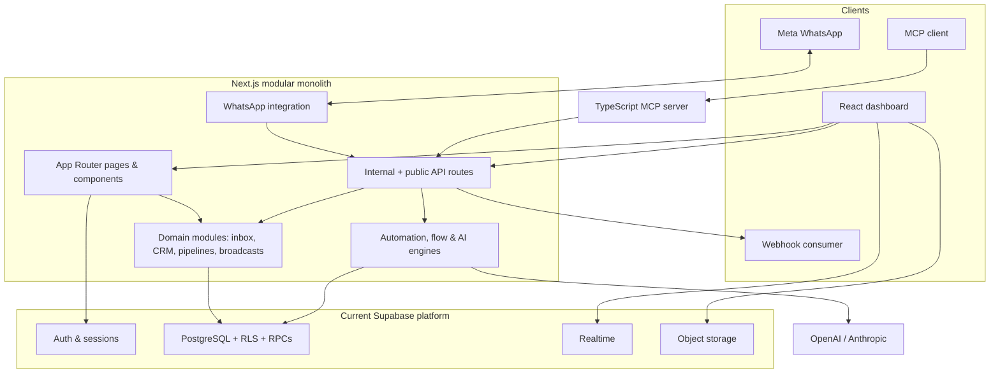
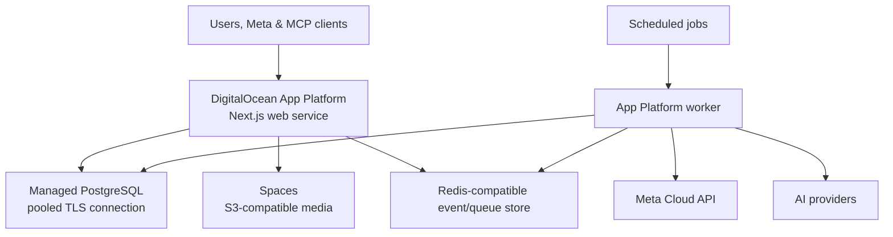
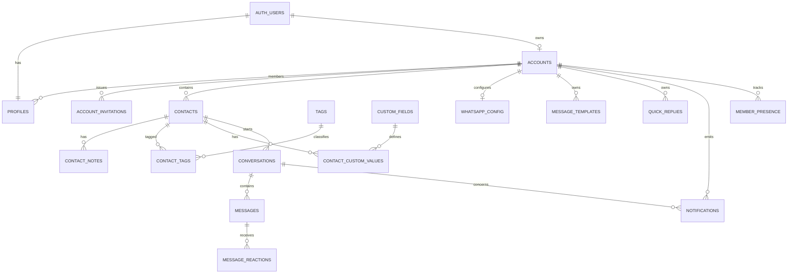
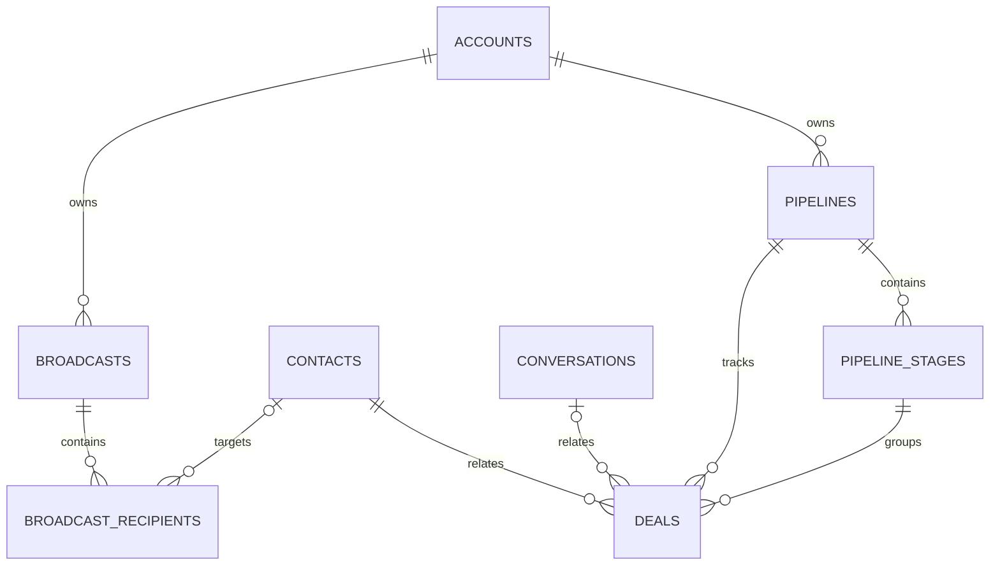
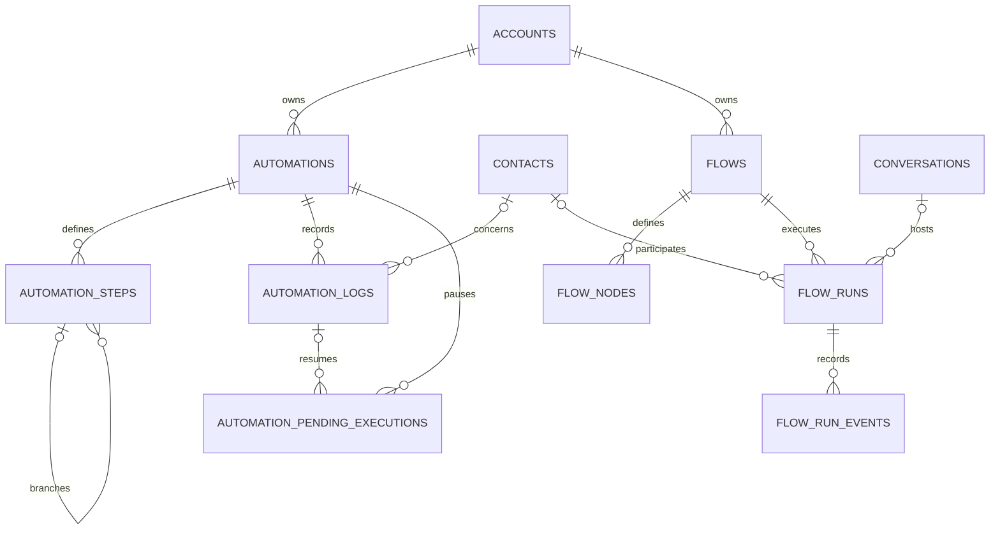
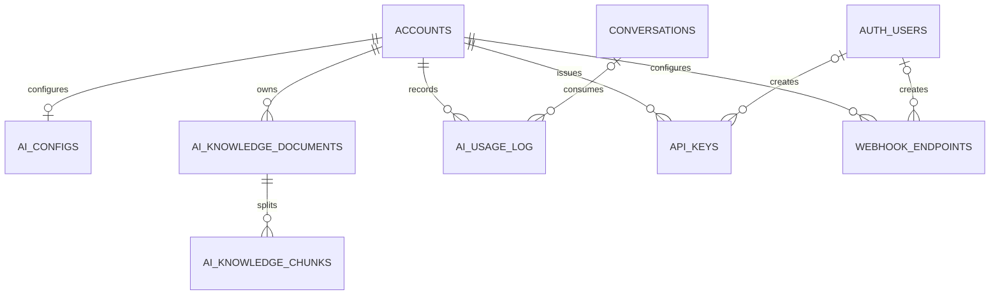
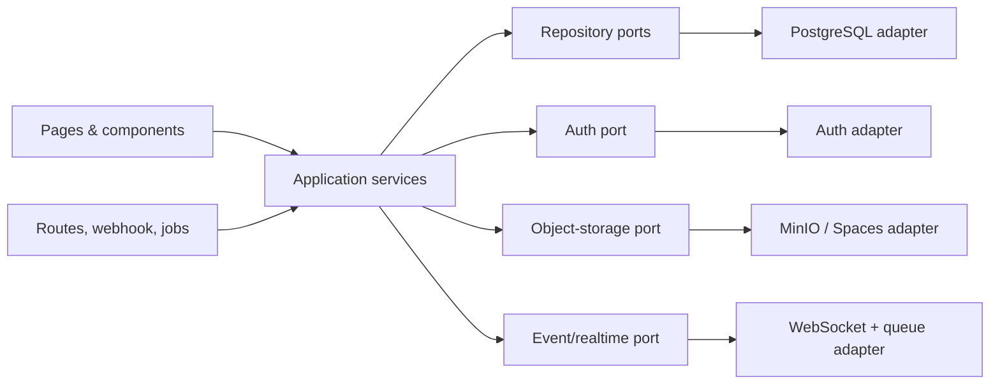

# Omni Connect AI — Technical Codebase Report

**Repository reviewed:** `summanbahadur-ai/omni-connect-ai`  
**Revision reviewed:** `80c3f9a`  
**Review date:** 2026-10-07  
**Upstream product identity:** the package and README identify the codebase as `wacrm` v0.8.0, a self-hostable WhatsApp CRM template.

## Executive summary

This is a full-stack TypeScript **modular monolith** built on Next.js App Router. One deployable Next.js service serves the React UI, server-rendered pages, REST endpoints, Meta WhatsApp webhooks, cron endpoints, and application logic. A second, independently runnable TypeScript package in `mcp-server/` exposes the public REST API as Model Context Protocol tools.

Supabase is much more than the current SQL host. The application uses six Supabase capabilities: PostgreSQL, PostgREST-style queries, Auth and cookie refresh, Row-Level Security (RLS), Realtime change feeds, and Storage. It also relies heavily on PostgreSQL functions, triggers, JSONB, arrays, full-text search, and optionally `pgvector`. Replacing only the hosted database is straightforward if PostgreSQL is retained; completely removing Supabase is a substantial application migration because 167 of 393 TypeScript/TSX files contain Supabase-facing calls.

The recommended end state is:

- PostgreSQL 16+ locally in Docker and DigitalOcean Managed PostgreSQL in production.
- A server-only data-access layer using Drizzle, Prisma, or Kysely; do not expose the database directly to browsers.
- Auth.js or Better Auth for application sessions and password/OAuth workflows.
- S3-compatible object storage: MinIO locally and DigitalOcean Spaces in production.
- A WebSocket/SSE gateway plus PostgreSQL `LISTEN/NOTIFY`, an outbox, or Redis pub/sub for realtime UI updates.
- Existing business tables, PostgreSQL triggers/functions, account model, and `account_id` tenancy preserved during the first migration phase.

SQLite is suitable only for a constrained single-user development edition. It is not a drop-in replacement because this schema uses PostgreSQL RLS, functions, triggers, UUIDs, JSONB, arrays, full-text search, logical-replication-backed realtime, and optional vectors.

## 1. Technical inventory

### 1.1 Repository size and structure

At the reviewed revision:

| Measure | Count |
|---|---:|
| TypeScript/TSX files under `src/` | 393 |
| Test files under `src/` | 86 |
| Next.js API route handlers | 55 |
| Client components/hooks | 84 |
| Files with Supabase-facing operations | 167 |
| Sequential SQL migrations | 42 |

Important directories:

| Path | Responsibility |
|---|---|
| `src/app/(auth)` | Login, signup, password reset |
| `src/app/(dashboard)` | Authenticated product pages |
| `src/app/api` | Internal APIs, public v1 API, cron, WhatsApp webhook |
| `src/components` | Feature UI and shared UI primitives |
| `src/lib` | Business logic, integrations, auth helpers, data queries |
| `src/hooks` | Auth, realtime, presence, unread-count client behavior |
| `src/types` | Shared application/domain TypeScript types |
| `supabase/migrations` | Complete PostgreSQL schema evolution, RLS, RPCs, triggers |
| `mcp-server` | Separate stdio MCP server that calls `/api/v1` |
| `messages` | English, Korean, Portuguese, and Spanish catalogues |

### 1.2 Frontend stack

| Area | Technology | Evidence / role |
|---|---|---|
| Framework | Next.js 16.3.5 App Router | `package.json`, `src/app/` |
| UI runtime | React 19.2.4 | Server and client components |
| Language | TypeScript 6 | Strictly typed application and MCP server |
| Styling | Tailwind CSS 4 | `postcss.config.mjs`, `src/app/globals.css` |
| Components | Base UI, shadcn conventions, class-variance-authority | `src/components/ui`, `components.json` |
| Icons/toasts | Lucide React, Sonner | Shared interaction feedback |
| Charts | Recharts plus local Tremor-derived components | Dashboard charts and pipeline analytics |
| Visual editors | XYFlow/React Flow and Dagre | Flow canvas and automatic node layout |
| Drag/drop | dnd-kit | Pipeline and builder interactions |
| Dates | date-fns | Formatting and dashboard ranges |
| Audio | opus-recorder | WhatsApp voice/audio creation |
| Internationalization | next-intl | Four message catalogues in `messages/` |
| Browser data access | `@supabase/ssr`, `@supabase/supabase-js` | Auth, CRUD, realtime, storage |

The UI is feature-oriented rather than a single generic component hierarchy. Large product surfaces—Inbox, Contacts, Pipelines, Broadcasts, Automations, Flows, Agents, Settings—each have page routes and feature components. Some pages are server components that load initial data; interactive screens are client components and often query Supabase directly.

### 1.3 Backend and application logic

There is no separate Express/Nest backend. The backend is the Next.js server runtime:

| Backend concern | Implementation |
|---|---|
| HTTP/API | Next.js route handlers in `src/app/api/**/route.ts` |
| Human authentication | Supabase Auth session cookies via `@supabase/ssr` |
| Machine authentication | Hashed, scoped API keys in `api_keys` |
| Authorization | Application role checks plus database RLS |
| Data access | Supabase JS query builder/PostgREST; no ORM |
| Privileged jobs | Service-role Supabase clients that bypass RLS |
| Async/event entry points | Meta webhook, cron routes, public webhooks |
| Business integrations | Meta WhatsApp Cloud API, OpenAI, Anthropic |
| Cryptography | Node crypto; AES-256-GCM for stored tokens/secrets, HMAC for webhooks |
| Tests | Vitest 4; unit and route tests with test doubles |
| Packaging | Multi-stage Node 20 Alpine Docker image |

Backend logic is divided mainly under `src/lib`:

- `whatsapp/`: Meta API calls, message/template construction, webhook validation, media mirroring, broadcast behavior.
- `automations/`: trigger validation, step tree, execution engine, delayed execution, Meta sends.
- `flows/`: interactive flow graph validation, dispatch and runtime engine.
- `ai/`: provider calls, prompt/context construction, knowledge chunking/retrieval, usage tracking, auto-reply and handoff.
- `auth/` and `account/`: account context, invitations, RBAC and team membership.
- `api/`, `api-keys/`, `webhooks/`: public API envelopes, credentials, rate limiting and outbound webhook delivery.
- `dashboard/`, `contacts/`, `inbox/`, `storage/`: feature-specific query and helper logic.

### 1.4 External systems

| System | Purpose |
|---|---|
| Meta WhatsApp Cloud API | Send/receive messages, templates, media, status callbacks |
| Supabase | PostgreSQL, PostgREST, Auth, Storage, Realtime, RLS |
| OpenAI or Anthropic | Optional bring-your-own-key drafting and auto-reply |
| External webhook consumers | Receive signed CRM events |
| MCP clients | Operate the CRM via the separate `mcp-server` and public API |

## 2. Architecture assessment

### 2.1 Architectural style

The code follows a **full-stack modular-monolith / vertical-feature architecture**, with these characteristics:

1. **Single deployable web application.** UI, server-side rendering, API handlers, webhook processing, cron work, and most business logic ship together.
2. **Feature modules.** Components and libraries are grouped by domains such as WhatsApp, flows, automation, AI, contacts, and auth.
3. **Database-enforced multi-tenancy.** Most domain rows carry `account_id`; RLS and the `is_account_member` helper enforce owner/admin/agent/viewer access.
4. **Event-driven edges.** The inbound Meta webhook updates contacts, conversations, messages, broadcasts, flows, automations, AI behavior, and outbound webhooks. Cron routes resume delayed workflows.
5. **Hybrid client/server data access.** Server routes use authenticated or service-role clients, while many client components talk directly to Supabase. This is convenient but creates strong platform coupling.
6. **Database-centric behavior.** Atomic operations and integrity behavior live in PostgreSQL RPC functions and triggers.

It is not strict Clean Architecture or Hexagonal Architecture. There is no universal repository interface or application-service boundary, and Supabase types/calls appear in UI components, hooks, route handlers, and domain services. Some modules are well isolated and testable, but the data-access boundary is inconsistent.

### 2.2 Runtime/module diagram

### 2.3 Main request/event flows

- **Dashboard request:** middleware refreshes/validates the Supabase session; server page resolves the profile/account; server or browser queries account-scoped rows; realtime channels refresh the visible state.
- **Inbound WhatsApp:** Meta POSTs a signed webhook; the route verifies HMAC, resolves the connected account, upserts contact/conversation/message data, mirrors media, updates delivery/broadcast state, then dispatches flow/automation/AI/outbound webhook behavior.
- **Outbound WhatsApp:** an authenticated user or API key calls a Next.js route; the route checks role/scope, decrypts the account token, calls Meta, and records the local message/status.
- **Automation/flow:** trigger metadata selects active definitions; engines walk JSON-configured steps/nodes, log state, and either complete or persist a pending execution for cron resumption.
- **Public API/MCP:** the MCP process converts tool calls to REST; `/api/v1` hashes the bearer key, resolves its account/scopes with a service-role client, rate-limits it, and executes explicitly account-filtered queries.

### 2.4 Architecture strengths

- Clear feature vocabulary and broad test coverage for domain helpers.
- Database constraints, RLS, and account scoping provide meaningful defense in depth.
- Official Meta API integration includes signature verification, token encryption, template lifecycle, delivery status, and media handling.
- Public API keys are hashed and scoped; outbound webhooks are signed and SSRF-checked.
- Docker packaging and environment separation are already present.
- PostgreSQL-native features suit CRM, audit, workflow, and retrieval workloads.

### 2.5 Risks and technical debt

| Risk | Impact |
|---|---|
| Supabase calls across 167 files | Replacement blast radius is high |
| Browser components query tables directly | A non-Supabase backend requires new HTTP/server-action contracts |
| Service-role client bypasses RLS | Every privileged query must explicitly include `account_id`; omissions are tenant-isolation defects |
| In-memory rate limiter | Limits are per process and reset on redeploy; ineffective across multiple replicas |
| Long-running work in route/cron processes | Broadcasts and workflows can exceed request/runtime limits and lack durable queue semantics |
| Business logic split between TypeScript and SQL RPCs/triggers | Migration requires an explicit inventory and parity tests |
| Sequential migrations describe evolution, not a clean baseline | New non-Supabase installs need a consolidated schema/migration strategy |
| Public storage URLs | Media authorization/privacy requirements should be reviewed before production use |

## 3. Why Supabase is used

Supabase provides an integrated backend that keeps the repository small:

1. **PostgreSQL:** all operational and audit data.
2. **PostgREST/query SDK:** `.from(...).select/insert/update/delete` and `.rpc(...)` without an application ORM.
3. **Authentication:** signup, login, password reset, session refresh, user identities in `auth.users`.
4. **Authorization:** RLS policies read `auth.uid()` and account membership.
5. **Realtime:** browser subscriptions to messages, conversations, reactions, notifications, and member presence.
6. **Storage:** `avatars`, `chat-media`, and `flow-media` buckets and their policies.
7. **Administrative bypass:** service-role clients process webhooks, cron, automation, AI, and machine API calls.

Official Supabase documentation confirms that Auth, PostgREST, Realtime, Storage, and PostgreSQL are separate services behind its gateway, while Realtime consumes PostgreSQL change streams and broadcasts over WebSockets. This explains why changing the SQL host alone does not replace the full platform.

## 4. Database replacement options

### Option A — Local/self-hosted Supabase

**Use when:** the immediate goal is local ownership or avoiding the hosted Supabase service, while minimizing code changes.

- Run the official Supabase Docker stack locally or on a VM.
- Retain current clients, Auth, Storage, Realtime, RLS, SQL migrations, and service-role semantics.
- Lowest application risk, but this does **not** remove the Supabase software dependency; it transfers operations to you.

### Option B — PostgreSQL plus independent services (recommended)

**Use when:** the goal is to remove Supabase while preserving production capabilities.

| Current capability | Local replacement | Production replacement |
|---|---|---|
| Supabase PostgreSQL | PostgreSQL 16+ Docker container | DigitalOcean Managed PostgreSQL |
| Supabase JS/PostgREST | Drizzle/Prisma/Kysely behind server routes | Same |
| Supabase Auth | Auth.js or Better Auth | Same, with secure cookies and email provider |
| Supabase Storage | MinIO | DigitalOcean Spaces |
| Supabase Realtime | WebSocket/SSE + `LISTEN/NOTIFY`/outbox | Web service + Redis/pub-sub or durable event relay |
| Supabase cron assumptions | Local cron/worker | DigitalOcean scheduled job or worker |
| In-memory rate limits | Redis-compatible local container | Managed Redis-compatible store |

Why PostgreSQL should remain:

- The schema and migrations are already PostgreSQL-specific.
- RLS, JSONB, arrays, triggers, PL/pgSQL, full-text search, and `pgvector` can remain.
- DigitalOcean Managed PostgreSQL offers TLS, backups/PITR, connection pooling, and managed operations.
- Local and production schemas can remain equivalent.

### Option C — SQLite

**Use when:** a deliberately reduced, single-user, offline/local edition is required.

This is not recommended for the full application. It would require replacing PostgreSQL RPCs/triggers, RLS, `auth.users` foreign keys, `TIMESTAMPTZ`/UUID conventions, arrays, FTS behavior, `pgvector`, concurrent job locking, and realtime propagation. Multi-agent inbox and background processing also create write-concurrency requirements that are a poor fit for a simple SQLite deployment.

### 4.1 Recommended migration sequence

Do not replace all six Supabase capabilities in one release. Use a strangler migration:

1. **Freeze behavior with contract tests.** Cover account isolation, role permissions, webhook idempotency, broadcast counters, flow/automation resume, AI retrieval, and storage URLs.
2. **Introduce ports/adapters.** Add interfaces for session/auth, repositories, object storage, realtime publishing, and transactional jobs. New code must depend on these interfaces, not `SupabaseClient`.
3. **Move all writes server-side.** Replace browser `.from`, `.rpc`, and `.storage` writes with authenticated Next.js route handlers/server actions.
4. **Adopt direct PostgreSQL access.** Create a consolidated schema and migrate server reads/writes to the selected query layer while initially retaining Supabase Auth/Realtime/Storage.
5. **Replace authentication.** Add application-owned user/session tables, migrate identities, replace middleware and `auth.uid()` assumptions, and change RLS to use transaction-local identity (for example `SET LOCAL app.user_id/account_id`) or enforce tenancy in repositories plus server-only DB credentials.
6. **Replace storage.** Implement S3-compatible signed upload/download URLs; migrate three buckets and stored object URLs/keys.
7. **Replace realtime.** Publish account-scoped events after commits; clients subscribe through an authenticated WebSocket/SSE endpoint.
8. **Extract workers.** Move broadcasts, delayed automation/flow execution, AI auto-replies, and webhook delivery to a durable queue/worker.
9. **Remove Supabase packages and variables.** Only after code search and parity tests show no Supabase client, RPC, Realtime, Storage, or Auth dependencies.

### 4.2 DigitalOcean deployment topology

The existing Dockerfile already builds a standalone Next.js server and can be deployed on App Platform. For production, add at least one worker component, a managed PostgreSQL cluster and pool, Spaces, centralized secrets, migration execution during release, health checks, logs/alerts, backups, and an externally reachable HTTPS webhook URL. DigitalOcean documents Next.js/App Platform deployment, Docker image deployment, managed PostgreSQL connection pools, and scheduled jobs.

## 5. Module catalogue

| Module | User-facing responsibility | Main code |
|---|---|---|
| Authentication | Signup, login, password reset, session lifecycle | `(auth)`, `middleware.ts`, `hooks/use-auth.tsx` |
| Accounts/team | Invitations, roles, ownership, presence | `lib/auth`, `lib/account`, account APIs, presence hooks |
| Dashboard | KPIs, response time, activity, pipeline value | dashboard page/components/lib |
| Inbox | Shared conversations, assignments, messages, reactions, media | inbox page/components, WhatsApp routes |
| Contacts | Profiles, tags, notes, custom fields, CSV import/dedupe | contacts page/components/lib |
| Pipelines | Kanban stages, deals, analytics | pipelines page/components |
| Broadcasts | Audience selection, templates, scheduling, delivery metrics/resume | broadcasts pages/components, WhatsApp broadcast logic |
| Automations | Trigger/condition/action tree, waits, logs, cron resume | automation pages, `lib/automations`, APIs |
| Interactive flows | Visual graph, validation, runs/events/fallback/handoff | flow pages/components, `lib/flows`, APIs |
| AI agents | Drafts, auto-reply, knowledge retrieval, usage | agents/settings, `lib/ai`, AI APIs |
| WhatsApp settings | WABA/phone configuration and template sync/submission | settings components and WhatsApp APIs |
| Notifications | Assignment notifications and browser alerts | notification page/hooks/components |
| Public API | Scoped REST access for contacts, conversations, messages, broadcasts, webhooks | `app/api/v1`, `lib/api*` |
| Outbound webhooks | Signed event delivery with retry/failure tracking | `lib/webhooks`, v1 webhook APIs |
| MCP server | AI-tool facade over public REST API | `mcp-server/` |

## 6. Database design and ERD

### 6.1 Tenancy model

`accounts` is the business tenant. `profiles` links an authenticated `auth.users` identity to one account and an `account_role`. Most root domain tables have `account_id`; child rows inherit tenancy through their parent relationships. Historical `user_id` columns remain on many rows as creator/owner/audit fields. RLS policies combine account membership with minimum-role rules.

### 6.2 Core CRM and messaging ERD

### 6.3 Sales and broadcast ERD

### 6.4 Automation and flow ERD

### 6.5 AI, API and integration ERD

### 6.6 Important database behavior

- `handle_new_user` creates a profile and personal account when an Auth user is inserted.
- Account/member RPCs implement invitation redeem/peek, role changes, removal, and ownership transfer.
- Broadcast recipient triggers increment aggregate delivery counters.
- Atomic RPCs create broadcasts with recipients and claim AI reply slots.
- Contact filtering by tags and AI full-text/semantic matching are database RPCs.
- Realtime publications cover operational tables used by the UI.
- Storage policies govern three buckets: avatars, chat media, and flow media.
- Webhook failure tracking, presence heartbeat, automation/flow counters, and contact dedupe use SQL functions.

## 7. Recommended target architecture

The most valuable extension before adding product features is an infrastructure boundary:

This boundary lets local and DigitalOcean deployments use the same application code. It also gives future extensions stable interfaces and removes the current need for UI modules to know a database vendor.

## 8. Verification notes and sources

This report was produced by inspecting application code, package manifests, the 42 SQL migrations, Docker configuration, environment template, tests, public API/MCP documentation, and direct Supabase call sites at revision `80c3f9a`.

External documentation used to validate current deployment/replacement claims:

- Supabase architecture and Auth: <https://supabase.com/docs/guides/auth/architecture>
- Supabase self-hosting with Docker: <https://supabase.com/docs/guides/self-hosting/docker>
- Supabase Realtime architecture: <https://supabase.com/docs/guides/realtime/architecture>
- DigitalOcean Next.js App Platform example: <https://docs.digitalocean.com/products/app-platform/getting-started/sample-apps/next.js/>
- DigitalOcean Managed Databases: <https://docs.digitalocean.com/products/databases/>
- DigitalOcean PostgreSQL connection pools: <https://docs.digitalocean.com/products/databases/postgresql/how-to/manage-connection-pools/>
- Auth.js getting started: <https://authjs.dev/getting-started>

